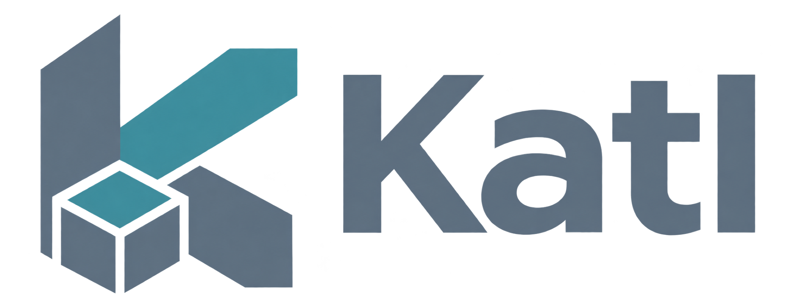

<h1 align="center">
  
</h1>

  

KatlOS is a Linux operating system for Kubernetes nodes in a home lab. Use
`katlctl` to install, configure, and update your nodes from your workstation.

KatlOS keeps the operating system and its configuration together as a bootable
version. If a host update fails its boot checks, the node can return to the
previous working version. Use the same cluster configuration to install the
nodes and set up Kubernetes. You manage the cluster network, backups, and
applications.

KatlOS supports x86-64 machines with UEFI on a trusted network.
[Check whether KatlOS fits your lab](docs/support.md).

- [Build your first KatlOS cluster](docs/getting-started.md) from the release ISO.
- [Browse the docs](docs/README.md) for other install methods, daily operations,
  and recovery.
- [Download a release](https://github.com/katl-dev/katl/releases) for the
  installer, workstation tools, and release notes.

## Contribute

[Developing Katl](docs/developing.md) shows how to build and test changes.
[Report a problem](docs/support.md#report-a-problem) or
[report a security issue privately](https://github.com/katl-dev/katl/security/advisories/new).

Katl uses the [MIT License](LICENSE).
